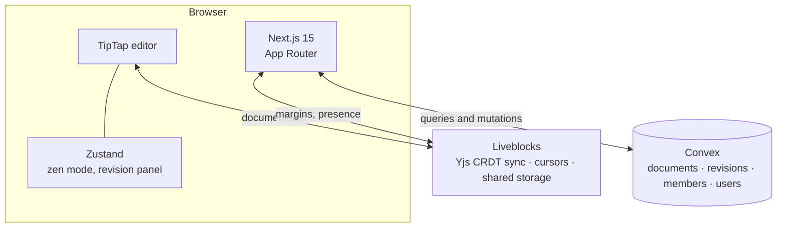
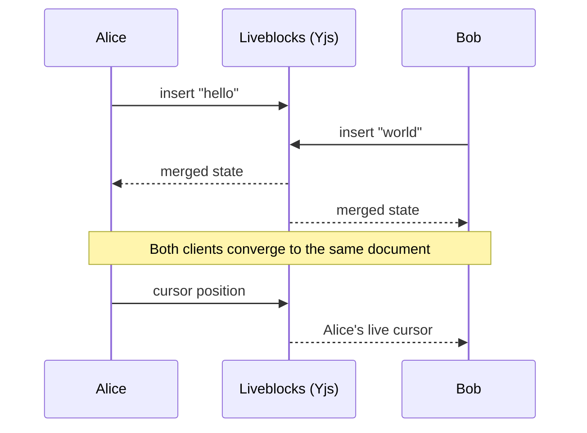

<div align="center">

```
███████╗██╗   ██╗███╗   ██╗ ██████╗██████╗  █████╗ ██████╗ 
██╔════╝╚██╗ ██╔╝████╗  ██║██╔════╝██╔══██╗██╔══██╗██╔══██╗
███████╗ ╚████╔╝ ██╔██╗ ██║██║     ██████╔╝███████║██║  ██║
╚════██║  ╚██╔╝  ██║╚██╗██║██║     ██╔═══╝ ██╔══██║██║  ██║
███████║   ██║   ██║ ╚████║╚██████╗██║     ██║  ██║██████╔╝
╚══════╝   ╚═╝   ╚═╝  ╚═══╝ ╚═════╝╚═╝     ╚═╝  ╚═╝╚═════╝ 
```

### A real-time collaborative document editor

CRDT sync · live cursors · version history with word-level diffs · smart compose

<br />

[](https://nextjs.org)
[](https://react.dev)
[](https://typescriptlang.org)
[](https://tailwindcss.com)
[](https://convex.dev)
[](https://liveblocks.io)
[](https://tiptap.dev)
[](./LICENSE)

<br />

[Demo](#demo) •
[Features](#features) •
[Architecture](#architecture) •
[Quick Start](#quick-start) •
[Verify](#verify-it-works) •
[Roadmap](#roadmap)

</div>

---

## Overview

SyncPad is a collaborative document editor built on a serverless stack. Text sync uses **CRDTs** through Liveblocks and Yjs, so several people can edit the same document at once without locks or last-write-wins data loss. It also has live cursors, margins shared across collaborators, saved revision snapshots with a word-level diff view, and a smart compose extension in the editor.

**Why CRDTs?** Operational Transformation needs a central server to order every edit. CRDTs let each client merge changes on its own and still converge to the same document.

## Demo

<!-- Replace with a real GIF. Show two windows side by side: typing, live cursors, margin drag, revision diff. -->
<div align="center">
  
</div>

## Features

| | Feature | Details |
|---|---|---|
| 🔄 | **Real-time collaboration** | CRDT sync through Liveblocks and Yjs, with no locks and no merge conflicts |
| ✍️ | **Rich text editor** | TipTap with headings, tables, images, task lists, links, font size, and line height |
| 🧠 | **Smart compose** | Writing suggestions from a custom TipTap extension |
| 🕓 | **Version history** | Snapshot revisions compared with a **word-level LCS diff** |
| 📐 | **Shared margins** | Drag-to-resize margins that sync to every collaborator via Liveblocks Storage |
| 🖥️ | **Zen mode** | Distraction-free writing, driven by Zustand UI state |
| 📁 | **Document management** | Create, rename, delete, and search documents |
| 🪪 | **Lightweight identity** | A name prompt with a session saved in `localStorage` |

## Architecture



### How two users stay in sync



### How conflict resolution works

- Every inserted item gets a unique ID made of a client ID and a logical clock.
- Concurrent inserts at the same position are ordered **deterministically** using those IDs, so every peer reaches the same result.
- Deletions are recorded as tombstones, which lets peers converge even when edits arrive out of order.
- Margins live in **Liveblocks Storage**, which is also CRDT-based.

<details>
<summary><b>Project structure</b></summary>

```text
syncpad/
├── src/
│   ├── app/
│   │   ├── (home)/              # Dashboard and document list
│   │   ├── api/                 # API routes (Liveblocks auth, etc.)
│   │   ├── documents/           # Editor page [documentId]
│   │   └── sign-in/             # Fallback sign-in page
│   ├── components/              # Shared UI (shadcn/ui + custom)
│   ├── extensions/              # Custom TipTap extensions
│   │   ├── font-size.ts
│   │   ├── line-height.ts
│   │   └── smart-compose.ts
│   ├── hooks/                   # use-debounce, use-mobile, use-search-param
│   ├── lib/
│   │   ├── diff.ts              # LCS word diff for revision history
│   │   └── utils.ts
│   └── store/                   # Zustand (editor, revision, zen mode)
└── convex/
    ├── schema.ts                # Database schema
    ├── documents.ts             # Document CRUD
    ├── revisions.ts             # Snapshots and revision history
    ├── members.ts               # Membership and access
    └── users.ts                 # User queries
```

</details>

## Quick Start

### Prerequisites

| Requirement | Notes |
|---|---|
| Node.js 18+ | [nodejs.org](https://nodejs.org) |
| Convex account | [convex.dev](https://convex.dev), free tier available |
| Liveblocks account | [liveblocks.io](https://liveblocks.io), free tier available |

### 1. Clone and install

```bash
git clone https://github.com/kelvinagyareyeboah/syncpad.git
cd syncpad
npm install
```

### 2. Add environment variables

Create `.env.local` in the project root:

```env
# Convex: from your Convex dashboard
NEXT_PUBLIC_CONVEX_URL=your-convex-deployment-url

# Liveblocks: Dashboard → API Keys (server-side only, never expose this)
LIVEBLOCKS_SECRET_KEY=your-liveblocks-secret-key
```

> [!CAUTION]
> `LIVEBLOCKS_SECRET_KEY` must stay server-side. Never prefix it with `NEXT_PUBLIC_`, and never commit `.env.local`.

### 3. Start Convex

```bash
npx convex dev
```

This deploys your schema and starts the serverless database. Keep this terminal open.

### 4. Start the app

In a second terminal:

```bash
npm run dev
```

Open **http://localhost:3000**.

## Verify It Works

- [ ] Open **http://localhost:3000** and create a document
- [ ] Open the same document URL in a second tab
- [ ] Type in one tab and see the text appear in the other
- [ ] Move your cursor and see the live cursor in the other tab
- [ ] Drag a margin handle and see it sync across tabs
- [ ] Save a revision snapshot and open **Version History**
- [ ] Compare two revisions and check the word-level diff
- [ ] Trigger **Smart Compose** and check that suggestions appear

## Tech Stack

| Layer | Technology | Role |
|---|---|---|
| Framework | Next.js 15, React 19 | App Router and UI |
| Language | TypeScript | Type safety |
| Styling | Tailwind CSS, shadcn/ui | Utility styles and accessible components |
| Database | Convex | Serverless DB with real-time queries |
| Collaboration | Liveblocks, Yjs | CRDT sync, live cursors, shared storage |
| Editor | TipTap | Rich text with custom extensions |
| UI state | Zustand | Zen mode and revision panel |

## Known Limitations

> [!WARNING]
> SyncPad is a portfolio project, and its identity system is not secure authentication.

| Limitation | Details |
|---|---|
| Identity | Users enter a name, so there are no verified accounts. Anyone with a document link can likely open it |
| Sharing | There is no invite flow or per-user permission enforcement yet |
| Offline | Edits need a connection to sync |

## Roadmap

**Shipped**

- [x] CRDT real-time collaboration (Liveblocks + Yjs)
- [x] Rich text editing (TipTap)
- [x] Live cursors
- [x] Shared margin control
- [x] Snapshot version history
- [x] Word-level LCS diff
- [x] Smart compose extension
- [x] Zen mode
- [x] Document CRUD and search

**Next up**

- [ ] Real authentication (Clerk or Auth.js)
- [ ] Sharing by invite link, with permissions
- [ ] Comments and threaded annotations
- [ ] Export to PDF, Markdown, and DOCX
- [ ] Offline mode and local-first sync
- [ ] Presence avatars
- [ ] Template gallery
- [ ] Mobile editor support

## Contributing

Contributions are welcome. For larger changes, please open an issue first.

```bash
git checkout -b feature/your-feature
git commit -m "Add your feature"
git push origin feature/your-feature
```

Then open a Pull Request.

## License

Released under the [MIT License](LICENSE). © 2025 [Agyare Kelvin Yeboah](https://kelvinagyareyeboah.me).

---

<div align="center">

### Built by Kelvin Agyare Yeboah

Co-founder @ [Zoharix](https://zoharix.tech)

[](https://github.com/kelvinagyareyeboah)
[](https://x.com/_yo_kelvin)
[](https://www.linkedin.com/in/agyarekelvinyeboah)
[](https://kelvinagyareyeboah.me)
[](https://zoharix.tech)

<br />

⭐ **If SyncPad was useful, give it a star.**

</div>
